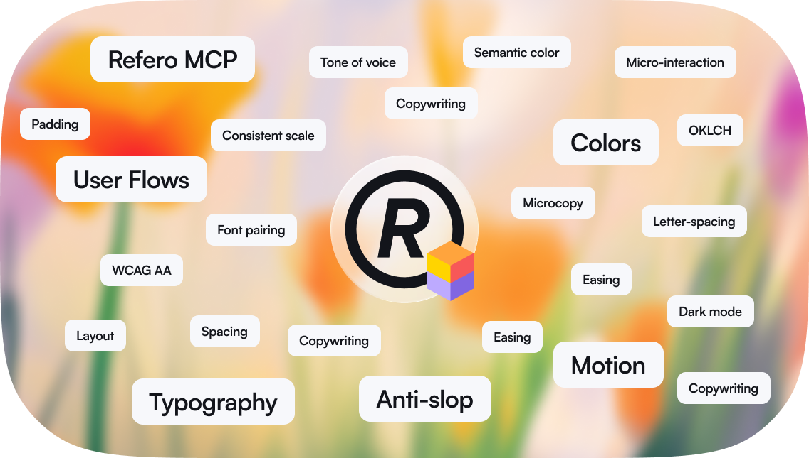

# Refero

Refero packages one design skill and one read-only MCP connection for AI design work.
The skill makes research mandatory before implementation. With live Refero research, agents
can use curated visual styles, 150,000+ real app screens, and 6,000+ user flows from
well-designed products.

This fork is also a **Claude plugin marketplace**: it can be added directly in Claude on
the web (claude.ai chat) with **Add marketplace**, without Claude Code and without
publishing a paid Directory listing.

## Install

### Claude on the web (claude.ai)

Works in the browser, the desktop app's Chat tab, and mobile — including the Free
web plan. No terminal, no Claude Code, and no Directory submission: **Add
marketplace** takes a repository directly, so no paid listing is required.

1. Open [Customize → Plugins](https://claude.ai/customize/plugins).
2. Choose **Add → Add marketplace → Add from a repository**.
3. Enter `osa822630-droid/refero_skill` (or the full
   `https://github.com/osa822630-droid/refero_skill` URL) and select **Sync**.
4. Add the **Refero** plugin from that marketplace.
5. Open **Customize → Plugins → Refero → Connectors**, add/connect the Refero
   connector, and finish the browser OAuth sign-in.
6. Start a new chat and ask for a design, e.g. "research references and design my
   pricing page".

claude.ai reads the repository's **default branch** (`master` in this fork; `main` if
you rename it), so keep the catalog and plugin there. After a push, use **Check for
updates** on the marketplace card to re-sync.

In chat the skill loads, but there is no shell, no file tools, and no `/mcp` command.
The skill adapts: research happens through the connected Refero connector, code is
delivered in the message or an artifact, and the reference lock is kept as a compact
state block you can paste into a new chat. Without the connector it falls back to the
bundled craft references instead of inventing Refero data. See
[plugins/refero/skills/refero-design/references/claude-web.md](plugins/refero/skills/refero-design/references/claude-web.md).

### Claude Code

```text
/plugin marketplace add osa822630-droid/refero_skill
/plugin install refero@refero
```

The marketplace name for CLI installs is `refero` (the catalog's `name`). claude.ai
names it after the repository instead.

### ChatGPT / Codex

[Install Refero from the OpenAI Plugins Directory](https://chatgpt.com/plugins/plugin_asdk_app_6a72258e6f18819183e5c4d8a56b78d9).

The plugin includes Refero MCP and Refero Skill. Sign in with your Refero account when prompted; no manual MCP config or separate skill installation is needed. Live research requires a paid Refero plan. See the [setup guide](https://doc.refero.design/mcp/getting-started).

### Codex app and CLI — install from GitHub

```bash
codex plugin marketplace add osa822630-droid/refero_skill
codex plugin add refero@refero
```

Restart the app after installation. The first connection opens Refero in the browser for
OAuth sign-in.

### Gemini CLI

```bash
gemini extensions install https://github.com/osa822630-droid/refero_skill
```

### Cursor

After the marketplace listing is approved, open Cursor's plugin marketplace or run
`/add-plugin` and search for **Refero**.

### Standalone skill

Use this when the client already has Refero MCP configured or only the design methodology
is needed:

```bash
npx skills add https://github.com/osa822630-droid/refero_skill/tree/master/plugins/refero --skill refero-design
```

The short form `npx skills add osa822630-droid/refero_skill --skill refero-design`
also works with recent versions of the CLI, which follow
`.claude-plugin/marketplace.json` into the plugin folder. If you renamed the default
branch, replace `master` in the tree URL.

No account is required for the bundled craft references. Live Refero research uses OAuth
when the MCP client first connects to `https://api.refero.design/mcp`.

## This fork

The marketplace catalog stays at the repository root and the plugin is a self-contained
folder at [plugins/refero/](plugins/refero/). This is deliberate: claude.ai's remote
marketplace sync validates each plugin entry, and it rejects a plugin that is also the
marketplace root (two manifests in one `.claude-plugin/` directory), a `"source": "."`
value, or a plugin entry without its own `plugin.json`. Moving the plugin into
`plugins/refero/` fixes all three while Claude Code, Codex, Cursor, Gemini CLI, and
standalone skill installs keep working.

```text
.claude-plugin/marketplace.json       Claude catalog (Claude Code + claude.ai)
.agents/plugins/marketplace.json      Codex catalog, same plugin folder
plugins/refero/                       the plugin claude.ai installs
  .claude-plugin/plugin.json          plugin manifest (strict mode requires it)
  .codex-plugin/plugin.json           Codex metadata
  .mcp.json                           remote Refero connector for chat/Cowork/Claude Code
  skills/refero-design/               canonical skill + references
  assets/                             icon and banner
  README.md, LICENSE                  shipped with the plugin
.mcp.json, mcp.json                   root-level MCP config for local clients
.cursor-plugin/, gemini-extension.json, server.json   other platforms
tests/test_marketplace.py             rules claude.ai's sync enforces
```

Version `1.0.4` marks the fork layout. All manifests share the version in `VERSION`.

## Troubleshooting Add marketplace

claude.ai often shows only "Failed to add marketplace" or "Marketplace sync failed.
Check the repository URL and try again." even when the cause is elsewhere.

- **A repository named `refero_skill` was added before.** claude.ai derives the
  marketplace name from the bare repo name (`refero_skill`), not from the catalog's
  `name`, and checks uniqueness before it reads the files. If you added the upstream
  `referodesign/refero_skill` or an earlier copy of this fork, remove that marketplace
  under **Customize → Plugins → Marketplaces** first, then add this one again.
- **An old sync is cached.** On the marketplace card choose **Check for updates**.
  If it still shows the pre-1.0.4 layout, remove the marketplace and re-add it. The
  plugin must resolve to `./plugins/refero`; a catalog that still says `"./"`
  (or `"."`) is an older copy of the repository.
- **The repository is private.** Make it public, or connect your GitHub account when
  the dialog asks and grant the Claude GitHub App access to this fork.
- **Changes are not on the default branch.** claude.ai syncs the default branch only.
  Merge into `master` (or `main` if renamed) before adding the marketplace.
- **Plugins is missing under Customize.** Your account or organization may not offer
  plugin marketplaces on that surface; check the plan/organization settings.
- **The plugin adds but live research fails.** Installing the plugin does not connect
  it. Add/connect the Refero connector on the plugin's **Connectors** tab and complete
  OAuth. Live MCP research also requires a Refero plan with MCP access.
- **The skill does not trigger.** Start a new chat after installing and ask "which
  skills do you have from plugins?", then mention Refero explicitly.

## What it does

1. Researches visual styles first, then real screens and user flows when the task needs them.
2. Extracts concrete patterns and locks references before implementation.
3. Applies bundled guidance for typography, color, spacing, motion, icons, and copywriting.
4. Keeps design decisions tied to evidence instead of generic AI defaults.
5. Checks substantial visual work against the selected direction before handoff.

## What is included

- `plugins/refero/skills/refero-design/` — the single canonical skill and its references.
- `plugins/refero/.mcp.json` — Refero MCP bundled with the plugin for chat, Cowork, and Claude Code.
- `.mcp.json` / `mcp.json` — the same MCP endpoint for local client installs.
- `.claude-plugin/`, `.agents/plugins/`, `.codex-plugin/`, `.cursor-plugin/` — platform metadata.
- `gemini-extension.json` — Gemini CLI extension manifest.
- `server.json` — official MCP Registry metadata.

All connection manifests use the same production endpoint and contain no access tokens.

## Existing standalone installations

Older clones placed `SKILL.md` at the repository root, and pre-1.0.4 clones placed it at
`skills/refero-design/`. Remove that old installation and run the standalone install
command again. The current skill lives at
`plugins/refero/skills/refero-design/SKILL.md`; keeping both layouts creates duplicate
skills.

For manual installation, copy the entire `plugins/refero/skills/refero-design/`
directory into the client's skills directory so its `references/` files remain beside
`SKILL.md`.

## Validate a release

```bash
scripts/check-release
python3 -m unittest discover -s tests -v
claude plugin validate .claude-plugin/marketplace.json
claude plugin validate plugins/refero --strict
```

The [release check](scripts/check-release) validates manifests, versions, local links,
the canonical MCP URL, package boundaries, and common secret leaks. The
[marketplace tests](tests/test_marketplace.py) enforce what claude.ai accepts when it
syncs a repository marketplace. Both run in CI; a real **Add marketplace** click on
claude.ai is still the final integration test.

## Security

Report vulnerabilities privately to [support@refero.design](mailto:support@refero.design).
See [SECURITY.md](SECURITY.md) for details.

## License

MIT
